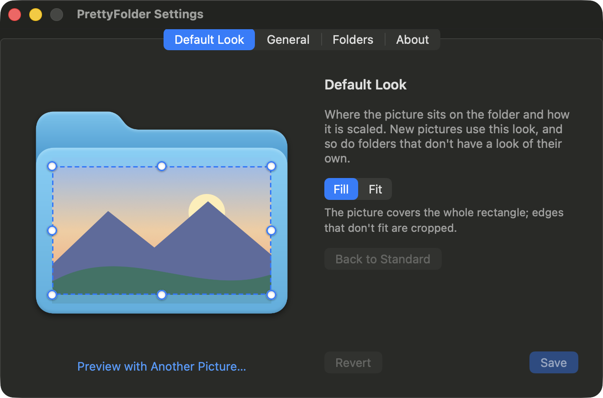

<p align="center">
  
</p>

<h1 align="center">PrettyFolder</h1>

<p align="center">
  Put any picture on a macOS folder icon in a second.<br>
  Drop it on the folder, click the folder's tab, or use the right-click menu.
</p>

---

macOS can already put a picture on a folder: Get Info, copy the picture, click the tiny icon, paste. PrettyFolder turns that into one step, places the picture *on* the folder instead of replacing the folder with it, and keeps all your folders looking consistent.

## Three ways to set a picture

**Drag and drop.** Drag a picture over a folder in Finder or on the Desktop. A small **Set as Icon** badge appears on top of the folder; drop the picture there. Dropping on the folder itself still copies the picture into it, exactly as before.

**Click the folder's tab.** Rest the pointer on a folder's tab, the raised strip at the top-left of its icon, and click the button that appears. Pick a picture and it is applied right away.

**Right-click.** Choose **Choose Folder Picture…** in a folder's context menu. Works for several folders at once.

Any image macOS can open works: JPEG, PNG, HEIC, WebP, AVIF, GIF, TIFF, BMP, PSD, RAW, JPEG XL, ICNS, PDF and SVG.

## Removing a picture

- Right-click › **Remove Folder Picture** (several folders at once, too)
- **Option-click** the tab button
- **Remove Current Picture** in the picker
- Settings › Folders › **Remove All Folder Pictures…** puts every folder back

## The look

<p align="center">
  
</p>

Drag the rectangle to move the picture on the folder, drag its handles to resize it. Hold Shift to keep its proportions; double-click it to start over.

- **Fill**: the picture covers the whole rectangle; edges that don't fit are cropped.
- **Fit**: the whole picture stays visible and grows until it touches the rectangle's sides.

The **default look** (Settings › Default Look) is what new pictures get. When you change it, PrettyFolder asks whether the folders that already have a picture should switch to the new look or keep the one they have.

Any folder can also have **its own look**: right-click › Folder Picture Options › **Adjust This Folder's Look…**

## Install

Requires macOS 14 Sonoma or later.

### Download

1. Download `PrettyFolder-x.y.z.zip` from [Releases](https://github.com/NarekMynell/PrettyFolder/releases), unzip it and move **PrettyFolder** to Applications.
2. The app is not notarized by Apple, so macOS blocks the first launch. Either open System Settings › Privacy & Security and click **Open Anyway**, or run this once:

   ```sh
   xattr -dr com.apple.quarantine /Applications/PrettyFolder.app
   ```

### Build from source

Requires Xcode 26 or later.

```sh
git clone https://github.com/NarekMynell/PrettyFolder.git
cd PrettyFolder
make install
```

### First launch

The welcome window walks you through two switches:

1. **Finder menu** turns on the Finder extension that adds the right-click items. You can also find it in System Settings › General › Login Items & Extensions.
2. **Accessibility** is only needed for the drop badge and the tab button: it lets PrettyFolder see which folder is under the pointer. It reads nothing else, and the right-click menu works without it.

PrettyFolder starts at login and sits in the menu bar; the icon can be hidden in Settings. There is also an optional Finder toolbar button (View › Customize Toolbar…).

## How it works

- The icon is written with `NSWorkspace.setIcon(_:forFile:options:)`, the same mechanism as pasting a picture in Get Info. Finder keeps it in a hidden `Icon\r` file inside the folder. Nothing is injected into Finder and no system files are touched.
- The picture is drawn onto the system's own folder artwork at every icon size, so it matches the macOS version you run.
- The drop badge and the tab button are small separate windows placed over Finder. PrettyFolder only observes mouse events, never alters them, and asks Finder through the Accessibility API which item is under the pointer.
- The Finder extension is sandboxed; it only tells the app which folders were clicked. If any other app asks PrettyFolder to remove pictures, it asks you first.
- A copy of each picture is kept in `~/Library/Application Support/PrettyFolder` so a folder's look can be changed later. If anything else changes a folder's icon, PrettyFolder leaves that folder alone.
- No network access, no analytics.

## Good to know

- Custom icons are fixed pictures, so they don't follow light and dark mode or tag colors.
- Apps and other packages are refused: an icon file inside an app bundle breaks its code signature.
- A folder under Git gets an untracked `Icon?` file. Add `Icon?` to your global gitignore.
- iCloud Drive doesn't carry custom folder icons to your other Macs.

## Uninstall

1. Settings › Folders › **Remove All Folder Pictures…** if you want the standard icons back.
2. Quit PrettyFolder from its menu and move it to the Trash (or run `make uninstall`).
3. Optionally delete `~/Library/Application Support/PrettyFolder`.

## Development

```
App/                        the menu bar app (SwiftUI and AppKit)
FinderExtension/            the Finder Sync extension
Packages/PrettyFolderKit/   image loading, icon rendering, folder bookkeeping, tests
Config/                     build settings, Info.plists, entitlements
Scripts/                    app icon generator, release packaging
```

- `make test` runs the unit tests. They change folder icons, but only in a temporary directory.
- `make run` builds a debug copy and starts it; `make install` puts a release copy in /Applications.
- Builds are ad-hoc signed, so no Apple account is needed. To sign with your own identity, create `Config/Local.xcconfig`:

  ```
  CODE_SIGN_IDENTITY = Apple Development
  DEVELOPMENT_TEAM = YOURTEAMID
  ```

  A stable identity also keeps the Accessibility permission across rebuilds; with ad-hoc signing macOS asks again after every rebuild.
- `make release` packs a zip for GitHub Releases. With `DEVELOPER_ID` and `NOTARY_PROFILE` set it is signed for distribution and notarized.

## License

[MIT](LICENSE)
