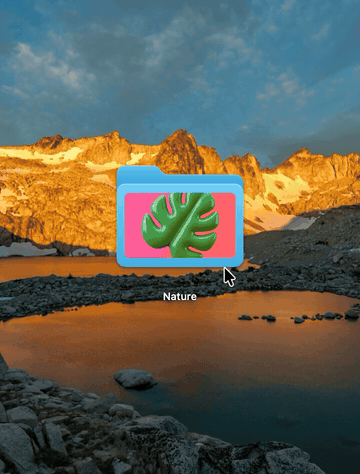
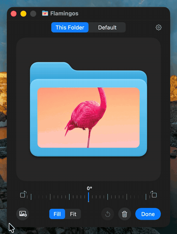
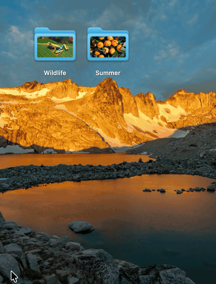

<p align="center">
  
</p>

<h1 align="center">PrettyFolder</h1>

<p align="center">Put any picture on a folder icon on your Mac.</p>

<table>
<tr>
<td width="33%" valign="top"><br><b>Drop a picture on a folder</b><br>Drag it over a folder and drop it on <b>Set as Icon</b>. A transparent PNG or an SVG leaves the folder showing around it.</td>
<td width="33%" valign="top"><br><b>Or use the buttons on it</b><br>Point at a folder in Finder's icon view or on the Desktop to choose a picture, take it off or open the window.</td>
<td width="33%" valign="top"><br><b>Any shape, any size, anywhere</b><br>Drag the handles or the frame, pinch or scroll. It snaps to the folder's lines and goes up to eight times the folder, tab and all.</td>
</tr>
<tr>
<td valign="top"><br><b>The part that shows, at any angle</b><br><b>Fill</b> or <b>Fit</b>. The right mouse button moves the picture in its frame. The dial, the buttons beside it or two fingers turn it.</td>
<td valign="top"><br><b>Several folders at once</b><br>Select them, right-click, <b>Folder Picture…</b>. A picture dropped on the window, and whatever you do there, goes to all of them.</td>
<td valign="top"><br><b>All your folders</b><br>Copies keep their picture, and moved folders stay known. A new default look can reach them all, and <b>Remove All Pictures…</b> takes everything off.</td>
</tr>
</table>

## Install

1. Download `PrettyFolder-<version>.zip` from the [latest release](https://github.com/NarekMynell/PrettyFolder/releases/latest), unzip it and move **PrettyFolder** to **Applications**.
2. Open it. PrettyFolder isn't notarized by Apple, so the first time macOS refuses to open it. Go to **System Settings › Privacy & Security**, scroll down and click **Open Anyway**. Or run this once in Terminal:

   ```sh
   xattr -dr com.apple.quarantine /Applications/PrettyFolder.app
   ```

3. In the window that opens, click **Turn On Finder Menu** and **Allow Accessibility**. PrettyFolder uses Accessibility only to see which folder is under the pointer.

PrettyFolder starts with your Mac and lives in the menu bar. Needs macOS 14 Sonoma or later.

## Good to know

- **Pictures:** JPEG, PNG, HEIC, WebP, GIF, TIFF, PSD, RAW, PDF, SVG and anything else macOS can open.
- **Frame:** ⇧ keeps the proportions, ⌥ resizes around the middle, ⌘ turns snapping off. Arrow keys nudge it, and ⌘+ and ⌘− resize it.
- **Picture:** Control-drag, or double-click and drag, moves it too, and so do ⌥ and the arrow keys. ⌘L and ⌘R make quarter turns. On the dial, ⇧ turns in steps of 15° and a double-click makes the picture upright.
- **Default look:** the one new pictures get. Saving it asks whether the folders using it should change too.
- **Behind the gear:** open at login, the menu bar icon, the buttons on folders, **Redraw All Pictures** and **Remove All Pictures…**. Backups and clones of a whole Mac are left alone.

## Uninstall

1. In PrettyFolder's window, click the gear, then **Remove All Pictures…** to get the standard folder icons back.
2. Click **Quit** and move PrettyFolder from Applications to the Trash.

## Build from source

Needs Xcode 26 or later.

```sh
git clone https://github.com/NarekMynell/PrettyFolder.git
cd PrettyFolder
make install
```

`make test` runs the tests, and `make readme-media` draws the animations in this README from the app's own views.

## License

[MIT](LICENSE)
