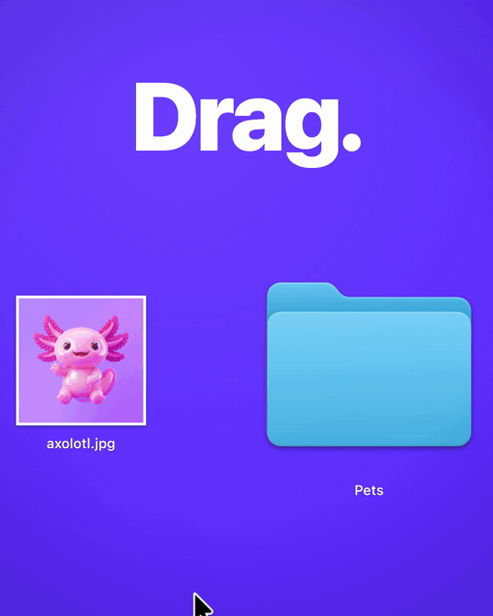
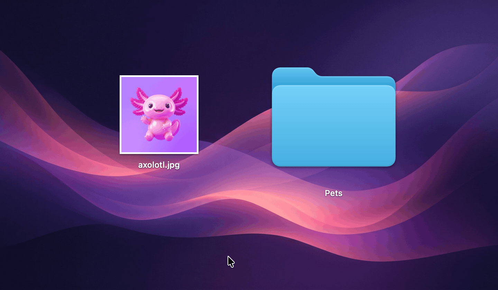
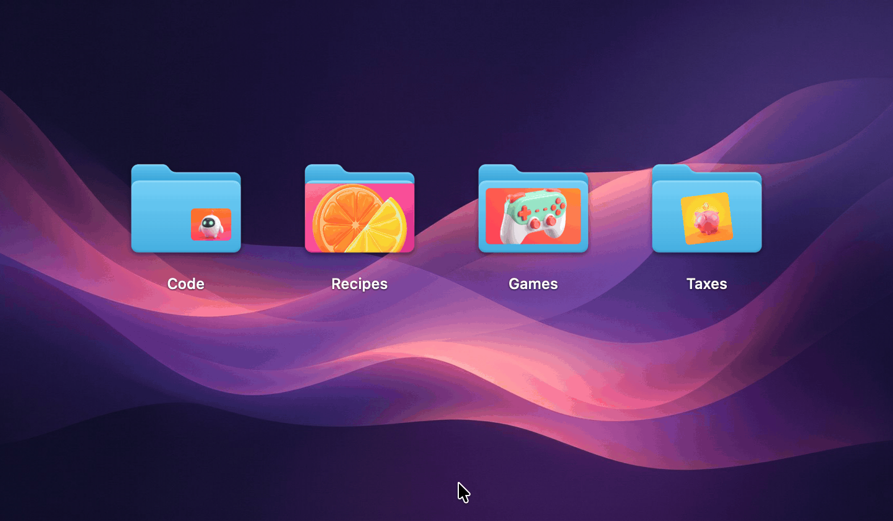
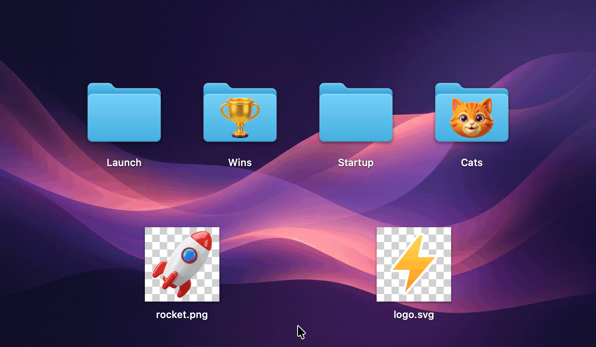
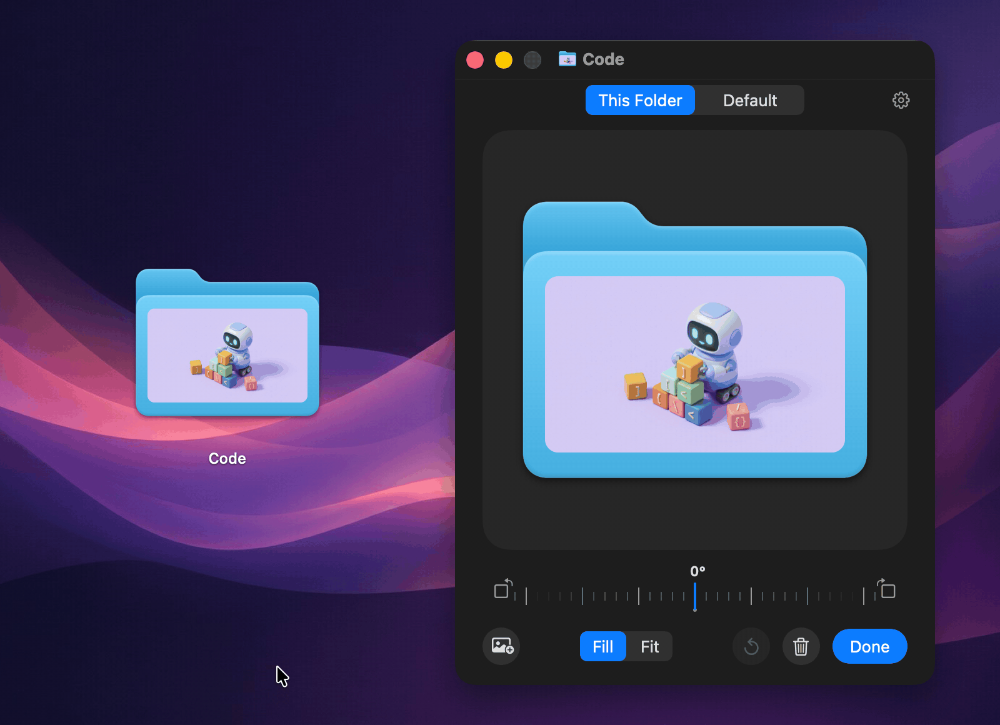
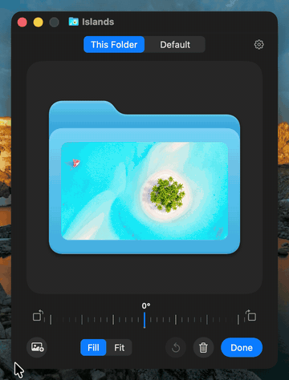
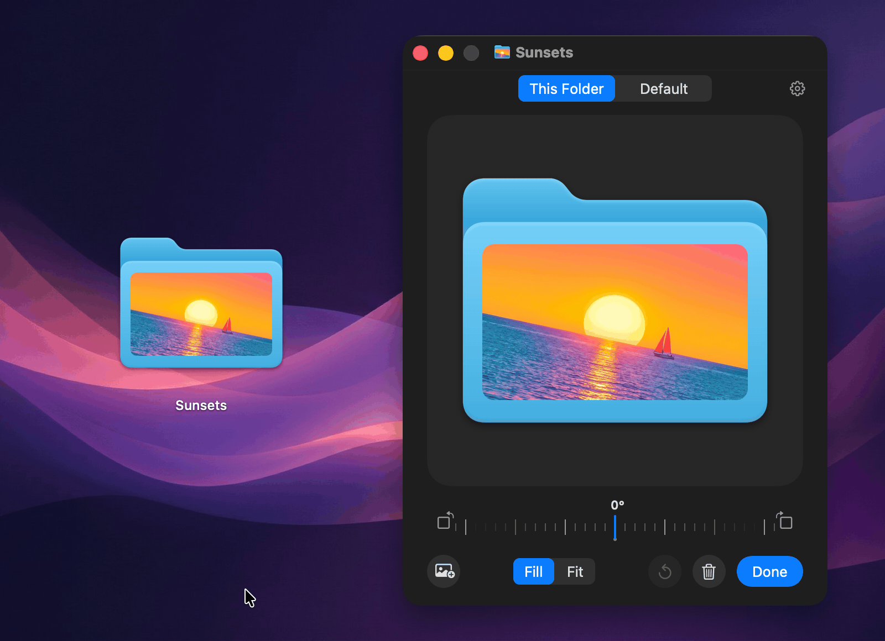
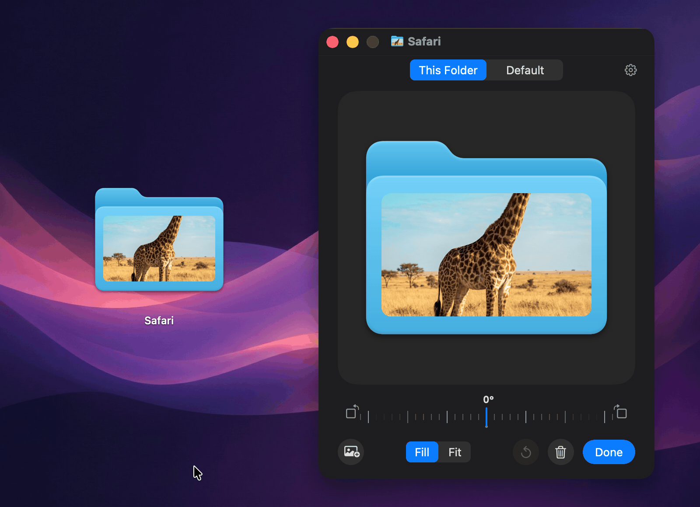
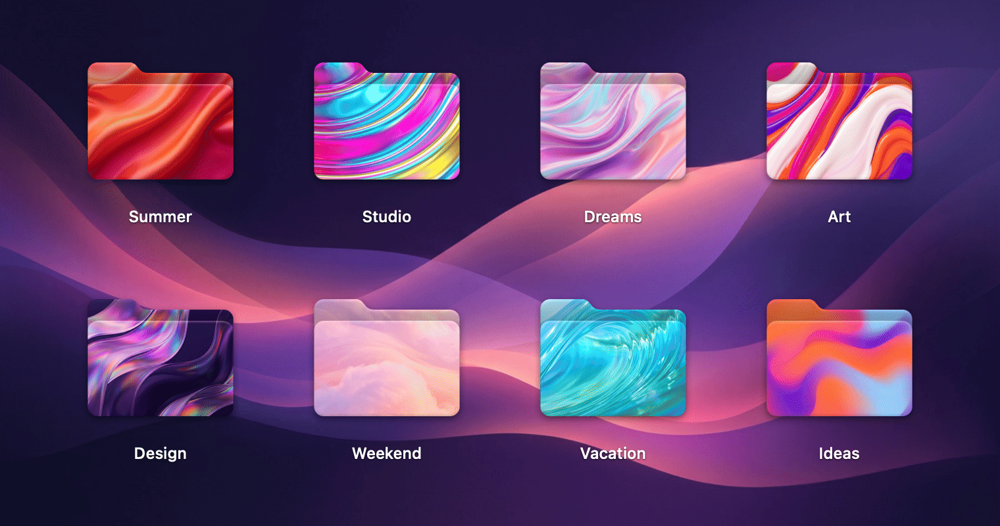

<p align="center">
  
</p>

<h1 align="center">PrettyFolder</h1>

<p align="center">Put any picture on a folder icon on your Mac.</p>

<p align="center">
  
</p>

## Install

1. Download `PrettyFolder-<version>.zip` from the [latest release](https://github.com/NarekMynell/PrettyFolder/releases/latest), unzip it and move **PrettyFolder** to **Applications**.
2. Open it. PrettyFolder isn't notarized by Apple, so the first time macOS refuses to open it. Go to **System Settings › Privacy & Security**, scroll down and click **Open Anyway**. Or run this once in Terminal:

   ```sh
   xattr -dr com.apple.quarantine /Applications/PrettyFolder.app
   ```

3. In the window that opens, click **Turn On Finder Menu** and **Allow Accessibility**. PrettyFolder uses Accessibility only to see which folder is under the pointer.

PrettyFolder starts with your Mac and lives in the menu bar. Needs macOS 14 Sonoma or later.

## Use

### 1. Drop a picture on a folder



Drag a picture over a folder and drop it on **Set as Icon**. Dropping it on the folder itself works as always.

### 2. Point at a folder



Buttons appear on top of the folder: choose a picture, remove it, or open the folder in PrettyFolder's window. This works in Finder's icon view and on the Desktop. You can also right-click one folder or several and choose **Folder Picture…**.

### 3. Logos and cut-outs



A transparent PNG or an SVG leaves the folder showing all around it, so a logo or a cut-out sits right on the folder. SVGs stay sharp at every size.

### 4. Any size, anywhere



Point at the folder in the window and a thin frame shows up around the picture. Pinch or scroll to make it smaller or bigger, drag it anywhere on the folder, and drag its handles to change its shape.

### 5. Zoom in



Make the frame bigger than the folder, up to eight times, to zoom into part of the picture, and drag it to choose which part.

### 6. Turn it to any angle



Drag the dial under the folder and the picture turns with it, to any angle. The dial shows the angle as you go and sticks to upright and to quarter turns; hold ⇧ for steps of 15°. Scroll on it or use the arrow keys to turn a degree at a time, and double-click it to make the picture upright again. The buttons on either side of it turn the picture a quarter turn. You can also twist two fingers on the trackpad, or drag just outside a corner of the frame.

### 7. Fill or Fit



**Fill** covers the whole frame; drag the picture with the right mouse button (or hold Control, or double-click and drag) to choose the part that shows. **Fit** shows the whole picture inside the frame.

### 8. Make the whole folder a picture



Stretch the frame over the whole folder and the picture covers it right up to its outline, back and front, with the folder's own light and shade.

### Good to know

- Everything snaps to the folder's edges and middle. Hold ⇧ to keep the proportions, ⌥ to resize around the middle, ⌘ to turn snapping off.
- Arrow keys nudge the frame, ⌥ and the arrow keys nudge the picture, ⌘+ and ⌘− make the frame bigger or smaller, and ⌘L and ⌘R turn the picture a quarter turn.
- The folder changes as you go, ⌘Z undoes, and **Done** closes the window.
- **Default** is the look new pictures get. When you save it, PrettyFolder asks whether the folders already using it should change too.
- Any picture macOS can open works: JPEG, PNG, HEIC, WebP, GIF, TIFF, PSD, RAW, PDF, SVG and more.

## Uninstall

1. In PrettyFolder's window, click the gear, then **Remove All Pictures…** to get the standard folder icons back.
2. Click **Quit** and move PrettyFolder from Applications to the Trash.

## Build from source

Needs Xcode 26 or later.

```sh
git clone https://github.com/NarekMynell/PrettyFolder.git
cd PrettyFolder
make install
```

`make test` runs the tests, and `make readme-media` draws the pictures and animations in this README from the app's own views.

## License

[MIT](LICENSE)
