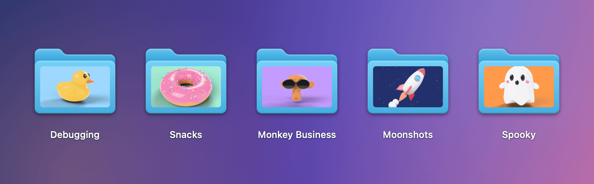
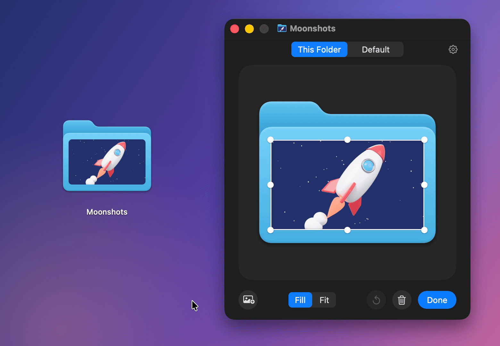

<p align="center">
  
</p>

<h1 align="center">PrettyFolder</h1>

<p align="center">Put any picture on a folder icon on your Mac.</p>

<p align="center">
  
</p>

## Install

1. Download `PrettyFolder-<version>.zip` from the [latest release](https://github.com/NarekMynell/PrettyFolder/releases/latest), unzip it and move **PrettyFolder** to **Applications**.
2. Open it. PrettyFolder isn't notarized by Apple, so the first time macOS refuses to open it. Go to **System Settings › Privacy & Security**, scroll down and click **Open Anyway**. Or run this once in Terminal:

   ```sh
   xattr -dr com.apple.quarantine /Applications/PrettyFolder.app
   ```

3. In the window that opens, click **Turn On Finder Menu** and **Allow Accessibility**. PrettyFolder uses Accessibility only to see which folder is under the pointer.

PrettyFolder starts with your Mac and lives in the menu bar. Needs macOS 14 Sonoma or later.

## Use

### Drop a picture on a folder


Drag a picture over a folder and drop it on **Set as Icon**. Dropping it on the folder itself works as always.

### Point at a folder


Buttons appear on top of the folder: choose a picture, remove it, or open the folder in PrettyFolder's window. This works in Finder's icon view and on the Desktop.

You can also right-click a folder and choose **Folder Picture…**, for one folder or several.

### Fine-tune it



Drag the frame's edge to move it and its handles to resize it. Drag the picture to move it inside the frame: with **Fill**, which covers the whole frame, to pick the part that shows; with **Fit**, which shows the whole picture, to pick where it sits. Everything snaps to the folder's edges and middle, and the picture never spills outside the folder. Where it covers both the back and the front of the folder, it takes on the folder's light and shade. The folder changes right away, ⌘Z undoes, and **Done** closes the window.

Hold ⇧ to keep the proportions, ⌥ to resize around the middle, ⌘ to turn snapping off. Arrow keys nudge the frame, ⌥ and arrow keys the picture, and a double-click puts the picture back in the middle.

**Default** is the look new pictures get. When you save it, PrettyFolder asks whether the folders already using it should change too.

Any picture macOS can open works: JPEG, PNG, HEIC, WebP, GIF, TIFF, PSD, RAW, PDF, SVG and more.

## Uninstall

1. In PrettyFolder's window, click the gear, then **Remove All Pictures…** to get the standard folder icons back.
2. Click **Quit** and move PrettyFolder from Applications to the Trash.

## Build from source

Needs Xcode 26 or later.

```sh
git clone https://github.com/NarekMynell/PrettyFolder.git
cd PrettyFolder
make install
```

`make test` runs the tests.

## License

[MIT](LICENSE)
