<p align="center">
  
</p>

<h1 align="center">PrettyFolder</h1>

<p align="center">Put any picture on a folder icon on your Mac.</p>

<p align="center">
  
</p>

## Install

1. Download `PrettyFolder-<version>.zip` from the [latest release](https://github.com/NarekMynell/PrettyFolder/releases/latest), unzip it and move **PrettyFolder** to **Applications**.
2. Open it. PrettyFolder isn't notarized by Apple, so the first time macOS refuses to open it. Go to **System Settings › Privacy & Security**, scroll down and click **Open Anyway**. Or run this once in Terminal:

   ```sh
   xattr -dr com.apple.quarantine /Applications/PrettyFolder.app
   ```

3. In the window that opens, click **Turn On Finder Menu** and **Allow Accessibility**. PrettyFolder uses Accessibility only to see which folder is under the pointer.

PrettyFolder starts with your Mac and lives in the menu bar. Needs macOS 14 Sonoma or later.

## Give a folder a picture

<table>
<tr>
<td width="33%" valign="top"><br><b>Drop it</b><br>Drag a picture over a folder and drop it on <b>Set as Icon</b>. Dropping it on the folder itself works as always.</td>
<td width="33%" valign="top">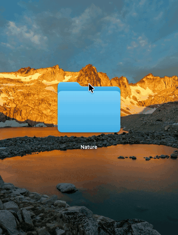<br><b>Choose it</b><br>Point at a folder in Finder's icon view or on the Desktop. Buttons appear on top: the first one picks a picture.</td>
<td width="33%" valign="top"><br><b>Take it off</b><br>The trash button puts the standard folder back.</td>
</tr>
<tr>
<td valign="top">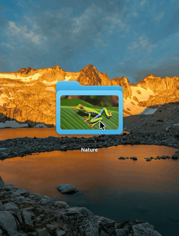<br><b>Open the window</b><br>The last button opens the folder in PrettyFolder's window, where everything below happens.</td>
<td valign="top">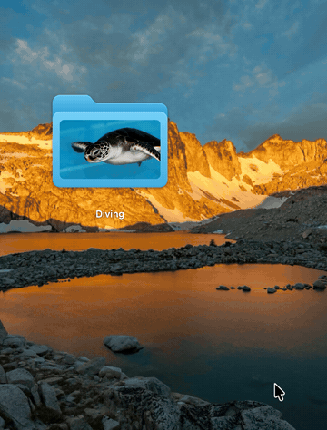<br><b>Or right-click</b><br>Finder's menu has one item from PrettyFolder, <b>Folder Picture…</b>, for one folder or several.</td>
<td valign="top"><br><b>Logos and cut-outs</b><br>A transparent PNG or an SVG leaves the folder showing around it. SVGs stay sharp at every size.</td>
</tr>
</table>

## Put it just where you want

<table>
<tr>
<td width="33%" valign="top"><br><b>Any size, anywhere</b><br>Pinch or scroll to change the size, and drag the frame anywhere on the folder.</td>
<td width="33%" valign="top">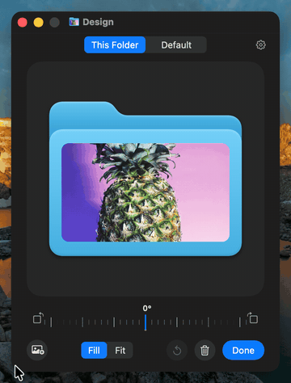<br><b>Any shape</b><br>Drag the handles. Everything snaps to the folder's edges and middle. ⇧ keeps the proportions, ⌥ resizes around the middle, ⌘ turns snapping off.</td>
<td width="33%" valign="top"><br><b>Zoom in</b><br>Make the frame up to eight times the folder, and drag it to choose the part that shows.</td>
</tr>
<tr>
<td valign="top">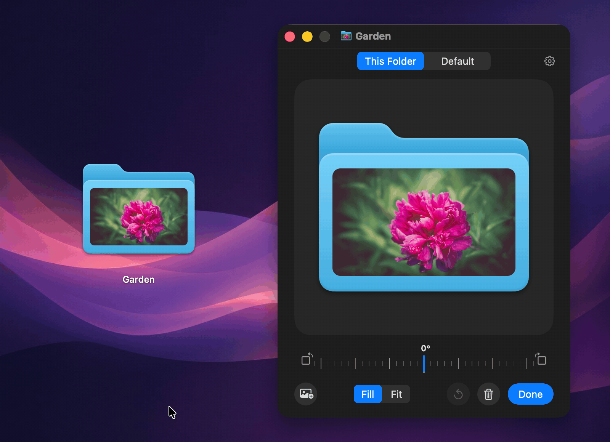<br><b>The whole folder</b><br>Stretch the frame over the folder, and the picture covers it right up to its outline, in the folder's own light and shade.</td>
<td valign="top">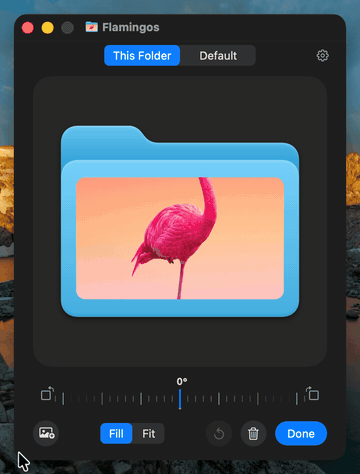<br><b>Choose the part</b><br>Drag with the right mouse button to move the picture inside its frame. Or hold Control, or double-click and drag.</td>
<td valign="top"><br><b>Fill or Fit</b><br><b>Fill</b> covers the whole frame. <b>Fit</b> shows the whole picture inside it.</td>
</tr>
<tr>
<td valign="top"><br><b>Any angle</b><br>Drag the dial. It sticks to upright and to quarter turns; ⇧ turns in steps of 15°, and a double-click makes the picture upright.</td>
<td valign="top">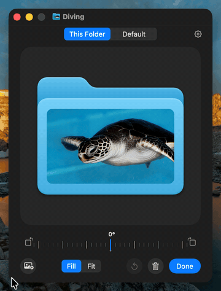<br><b>Quarter turns and a twist</b><br>The buttons beside the dial turn a quarter turn, and so do ⌘L and ⌘R. Twist two fingers on the trackpad for any angle.</td>
<td valign="top">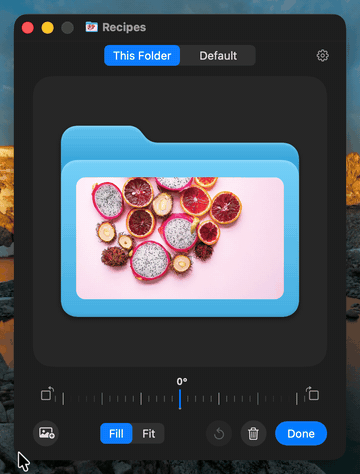<br><b>From the keyboard</b><br>Arrow keys nudge the frame, ⌥ and arrows nudge the picture, ⌘+ and ⌘− resize it, and ⌘Z undoes. <b>Done</b> closes the window.</td>
</tr>
</table>

## All your folders

<table>
<tr>
<td width="33%" valign="top">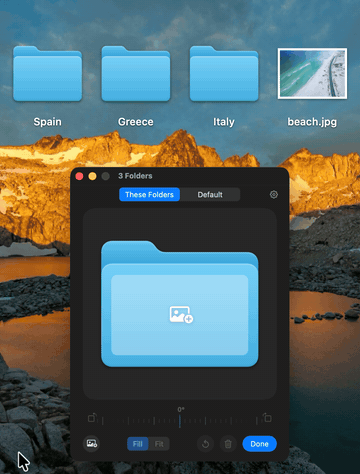<br><b>Several at once</b><br>Select folders and right-click. Drop a picture on the window, and whatever you do there happens to all of them.</td>
<td width="33%" valign="top">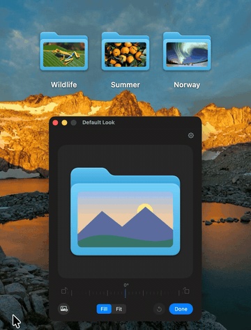<br><b>A default look</b><br><b>Default</b> is the look new pictures get. Saving it asks whether the folders using it should change too.</td>
<td width="33%" valign="top">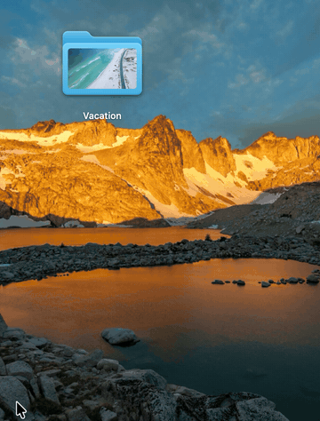<br><b>Copies and moves</b><br>A copy keeps its picture and gets a look of its own. A folder moved or renamed stays known, on any disk.</td>
</tr>
<tr>
<td valign="top">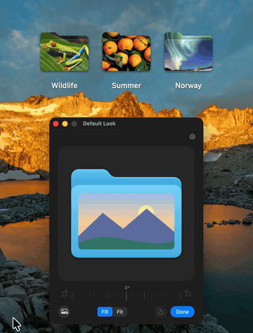<br><b>Everything behind the gear</b><br>Open at login, the menu bar icon, the buttons on folders, <b>Redraw All Pictures</b> and <b>Remove All Pictures…</b>.</td>
<td colspan="2" valign="top"><br><b>Any picture macOS can open</b><br>JPEG, PNG, HEIC, WebP, GIF, TIFF, PSD, RAW, PDF, SVG and more.</td>
</tr>
</table>

## Uninstall

1. In PrettyFolder's window, click the gear, then **Remove All Pictures…** to get the standard folder icons back.
2. Click **Quit** and move PrettyFolder from Applications to the Trash.

## Build from source

Needs Xcode 26 or later.

```sh
git clone https://github.com/NarekMynell/PrettyFolder.git
cd PrettyFolder
make install
```

`make test` runs the tests, and `make readme-media` draws the pictures and animations in this README from the app's own views.

## License

[MIT](LICENSE)
